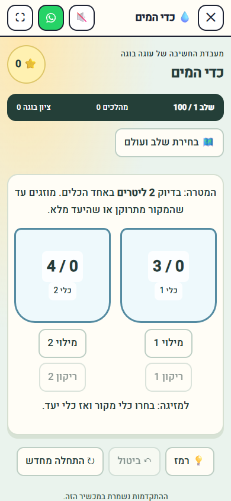
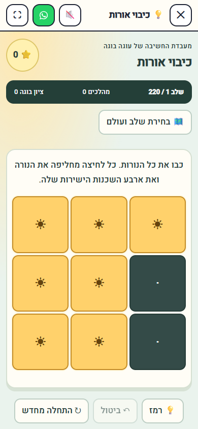
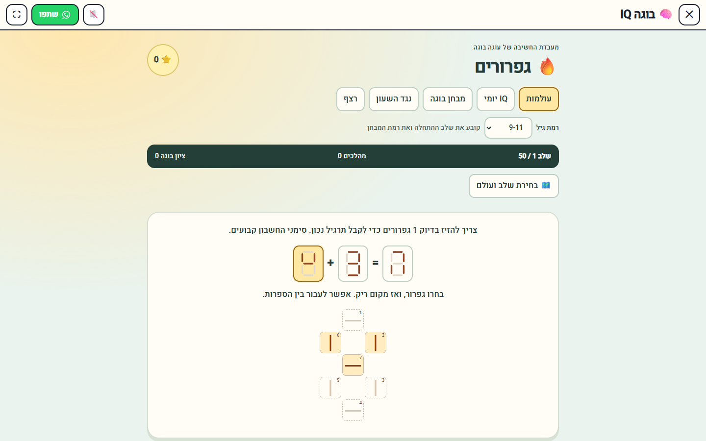

# Brain games review

## Scope and sequence

1. #106 — pure deterministic engines, catalogs, sessions and invariants; base `main`.
2. #107 — seven arcade entries and gameplay; base `feat/brain-puzzle-engines`.
3. `feat/brain-games-guides` — six editorial guides, canonical links, sitemap and browser SEO checks; base `feat/brain-games-play`.
4. #108 — independent one-line change: mount site chat only on `/`; base `main`.

These are draft review PRs. No merge, production deployment or database migration was performed. `main` remained at `0093833cc3f6a140d4e2a7c94a6763cebcd9d477` during the checks. Review the stacked game branches in order; retarget subsequent PRs after any approved preceding merge.

## Verified catalogs

| Game | Entries | Validation |
| --- | ---: | --- |
| Matchsticks | 200 | Exact 1–3 move/removal budgets; arithmetic and segment legality |
| Water jugs | 100 | Legal capacity transitions; BFS minimum paths |
| River crossing | 100 | Variable capacity/conflict graphs; safe-bank invariants and BFS |
| Cut the wire | 150 | Exhaustive permutations; exactly one answer to the question |
| Lights out | 220 | 3×3–6×6; GF(2) solver and minimum presses over nullspace |
| One move | 200 | Distinct starting states in four mechanics; one-action solutions |
| Buga IQ | 500 | 50 in each of ten worlds; 50 boss milestones |

The six standalone catalogs total **970** entries. IQ curates/reuses engines and some puzzles; **970 + 500 is not a claim of 1,470 globally distinct puzzles**. All published catalog entries are replay-validated. Standalone catalogs additionally pass distinct-start/rules checks. All deduction puzzles require a unique answer. Boss milestones are the last, hardest or tied-hardest entry in each sorted ten-level block, not a separate battle mechanic.

IQ supports persistent stars and active session, hints, daily selection by Israeli calendar day, daily completion streak, ten-world exam, age bands, an absolute five-minute deadline that survives reload, and a first-error streak. Scores and ranks are recreational, not psychometric.

## Validation

- `npx vite build`: passed on the final combined game/guide branch.
- `npx oxlint`: passed, no errors. Existing unrelated repository warnings remain; new brain files lint clean.
- `node --test tests/*.mjs`: **816/816 passed** on the game/guide branch. Independent chat branch: **795/795 passed**.
- `node scripts/audit/brain-smoke.mjs`: passed at **390×844** and **1440×900**. Solves all seven games and all ten IQ worlds through real controls, verifies reload/resume and no double awards, completes an exam, checks daily age independence, timer expiry, streak ending, 44px targets, reduced motion, no horizontal overflow and existing Solitaire/Spider/Traffic entry points.
- `node scripts/audit/brain-seo-smoke.mjs`: passed at both sizes. Six editorial pages and seven canonical game pages; one H1/canonical/description, visible FAQ content matching schema, valid internal links, no duplicate playable guide pages, no horizontal overflow or page errors.
- Curated sitemap and route metadata regenerated. The generated sitemap also picks up eight previously listed static URLs missing from the older generated file; no existing supplier URL was removed.
- Local prerender: `/brain-games` **6/6**, `/online-games` **37/37**, with zero failures and unique initial-HTML SEO metadata. The entire site's thousands of unrelated pages were not re-prerendered locally.
- Manual headless chat navigation check: visible on `/` and `/?source=test`; absent after SPA navigation and on arcade, kids and English routes; visible again on back navigation.

## Screenshots

## Implementation notes

- No new dependency, commercial asset, external AI or paid API. Art is CSS/SVG with generic Unicode symbols.
- Reuses arcade stage/registry, `useProgress` storage convention, site SEO components and Israeli calendar helper.
- Existing arcade daily rotation is intentionally unchanged. Brain campaigns are listed in `NOT_DAILY` because they use IQ's independent daily mode; poker exclusions remain intact.
- Saves are local to a browser/device. Invalid sessions recover to a new practice session; clearing site data removes progress. Age bands choose a starting level/exam range and do not diagnose ability.
- A scoped stage stacking rule prevents the pre-existing site chat from covering the new games before the independent homepage-only chat PR is approved.
