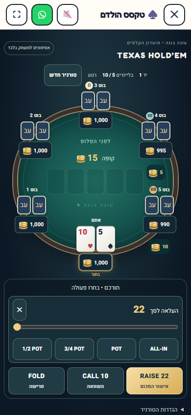
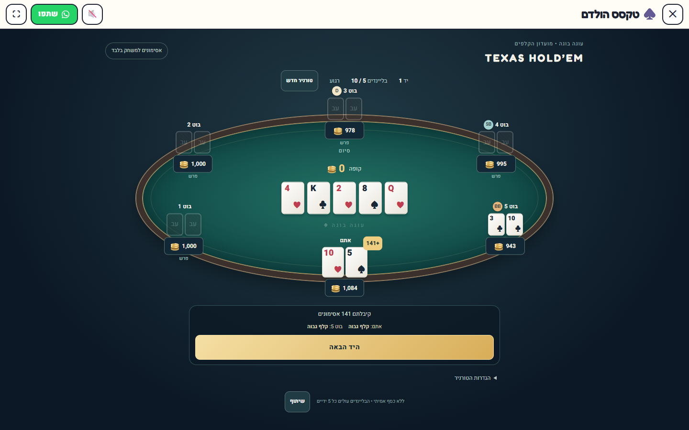

# Texas Hold’em rebuild

Based on main `81fc9d00a93a0c16ffe3158286392ac0c90975bf`, checked against the supplied export at `86a43b25488bba22a3ffe86e7875f212bcf9e7e0`. The newer main change excluding poker from the daily rotation is preserved.

## Engine contract

- `act(state, 'bet' | 'raise', amount)` uses an integer **raise-to total for the street**. Invalid amounts/actions return the original state. `bettingLimits` is the single source of truth for controls and AI.
- Seats retain their IDs when eliminated. The moving button skips busted seats; heads-up button posts the small blind, acts first before the flop and last afterward.
- `currentBet`, `lastRaise`, and per-seat `actedAt` retain action/reopening history. Short all-ins require calls without automatically reopening raises; cumulative short raises can reopen them. A checked player may raise an incomplete opening bet.
- Integer commitments form pots; unmatched excess is refunded separately. Ties award odd chips clockwise from the first seat left of the button. Settlement clears commitments and is idempotent.
- Blinds double every five hands, capped at 40,960 to avoid unbounded numeric growth. A single active player cannot raise into a dry side pot.

## AI and persistence

Easy/medium/hard use different noise, decision margins and controlled bluff rates. Decisions use private hole cards and public board only: pair/suited/connectivity strength, position, made hand and kicker, draws, paired/flush-heavy boards, pot odds, opponents remaining, SPR and pot-relative sizing. This is a lightweight heuristic opponent, not a solver or external AI service.

Version 2 saves the complete betting state and serializable PRNG state after every turn, including bot turns and completed hands. Reloading preserves the tournament and future randomness. Ordinary tournaments start with a fresh random seed; an explicitly supplied daily seed isolates its save and deterministically drives the same deal/decisions for the same actions. Poker remains excluded from the daily rotation on main.

Old version-1 saves lack enough history to reconstruct minimum raises safely. Their committed chips are refunded and the hand is redealt, preserving stacks/hand number/difficulty and displaying a migration notice. Settings are staged for a new tournament; replacing a tournament requires an explicit in-game confirmation.

## UI

Dedicated table/card styling, 2–6 seats, hero at the bottom, D/SB/BB, chip markers, turn/fold/all-in/elimination states, five board slots, showdown payouts and hand names. Raise slider and half/three-quarter/full-pot/all-in presets enforce the engine limits. Mobile retains the oval table and large controls; deal/chip animations respect reduced motion.

No shared production files were modified (`poker.js`, `cards.js`, `ui.jsx`, `hooks.js`, `card-polish.css`, `arcade.css`, daily routing all unchanged).

## Validation

Using the exact npm lockfile dependencies:

- `npx vite build`: passed. Existing large-chunk / mixed static-dynamic import warnings remain.
- `npx oxlint`: exit 0; existing repository warnings, no warnings in the modified game/engine.
- `node --test tests/*.mjs`: 792 passed, 0 failed.
- Production preview + `BASE_URL=http://127.0.0.1:5201 node scripts/audit/texas-holdem-smoke.mjs`: passed at 390×844 and 1440×900. Covers presets/slider, six-seat bounds, no horizontal overflow, on-screen actions, settings without reset, pending-bot reload, showdown, completed-hand reload, next hand, and restart cancellation.
- Engine tests include 375 AI-driven games and 500 randomized legal-action games checking chip conservation and termination, as well as explicit rule edge cases. Evaluator retained with extra seven-card regression cases.

Screenshots captured from the local production build:

No deployment or merge was performed.
