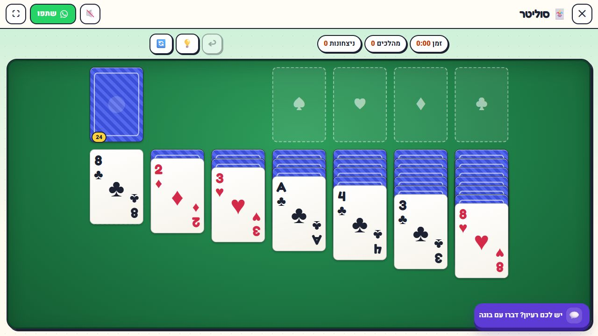
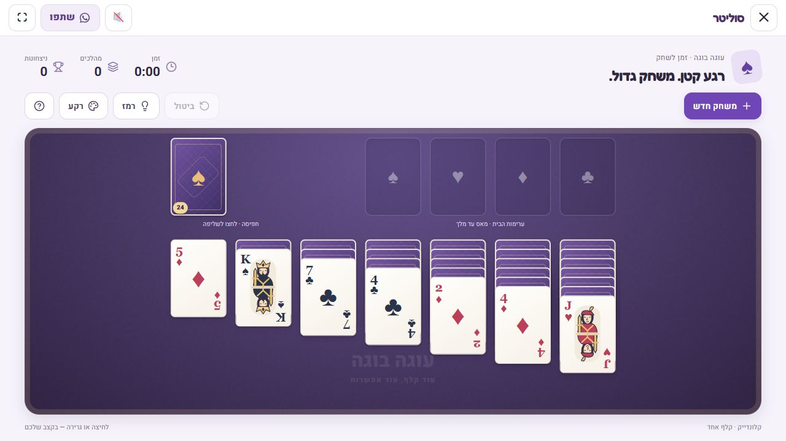
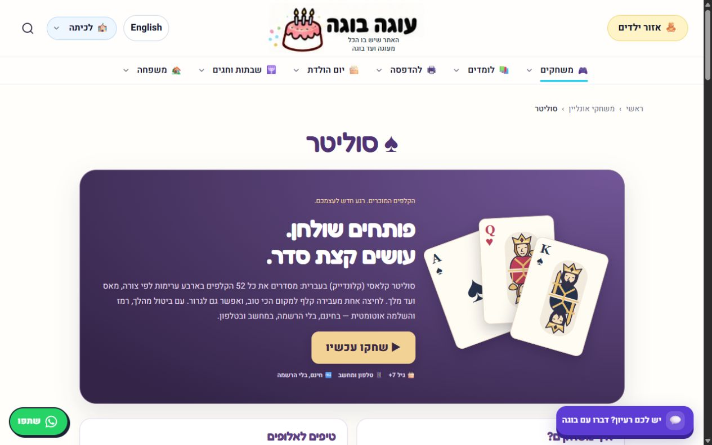
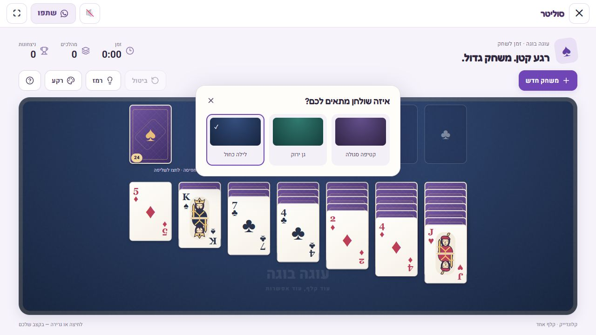
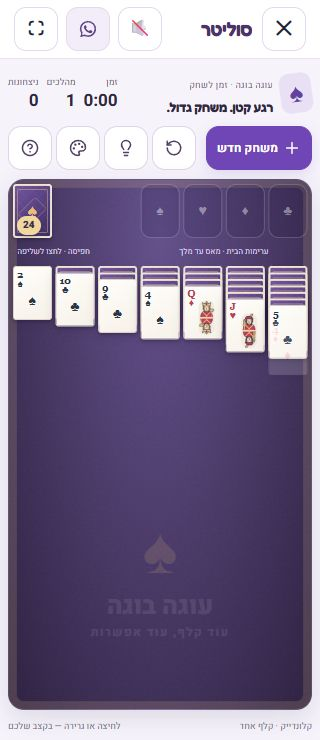
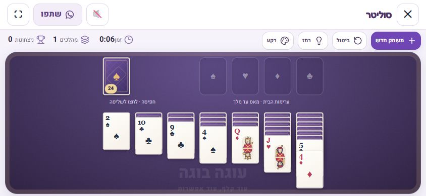
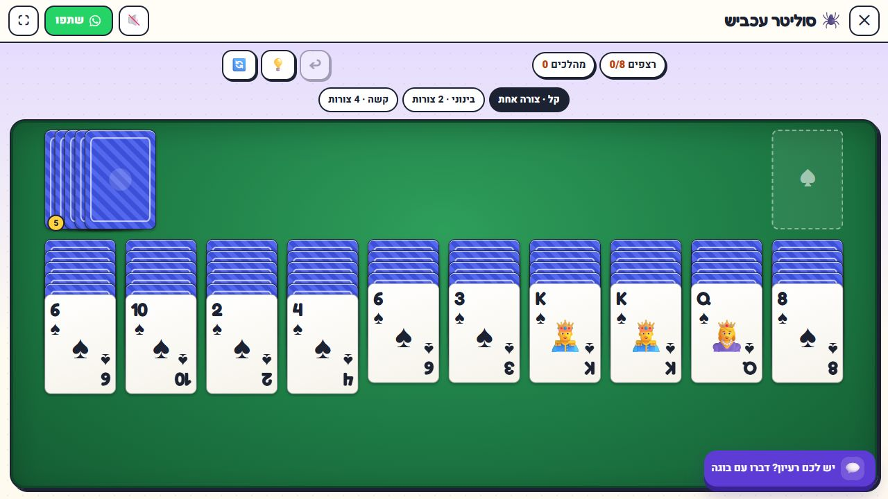

# Solitaire redesign verification

Based on main commit `a3bf899bdc1106bac70b014c3d79ef1898474651`, inspected alongside the live `/online-games/solitaire` page on 2026-10-17.

The referenced ChatGPT conversation was read, but its attachment list was empty. `solitaire-for-chatgpt.md` was not available in the conversation or the accessible local files, so no claims are made about having reviewed that historical document.

## Scope

Original mirrored SVG court illustrations, an illustrated landing page, three persistent table themes, labeled controls, responsive layouts, keyboard activation of playable cards/stock, reduced-motion support, and a confirmation before replacing a started game. Solitaire presentation is separate from `cardsUi.jsx`; Spider and the game-rule modules are unchanged. The route, canonical URL, SEO title/description and structured-data generation remain intact.

## Checks

- Dependencies installed using `npm ci --ignore-scripts` with the original package lock; no dependency changes committed.
- `node --test tests/*.mjs`: **692 passed, 0 failed**, including Klondike rules/card conservation, automatic finish, deterministic winnable daily deals, and Spider rules.
- `vite build`: passed. Existing bundle-size/dynamic-import warnings remain. This is the Vite production build, not the full site-wide prerender pipeline.
- `oxlint`: passed with existing repository warnings. Targeted lint of all changed JSX: clean.
- Browser: stock draw via Enter, undo, ace-to-foundation via Enter, legal drag between tableau columns, hint, theme switching and persistence across reload, restart cancellation, and preserved canonical URL.
- Responsive visual checks at 320×740, 390×844, 844×390 and desktop. The five toolbar controls at 320px are at least 44×44px. No horizontal game overflow at 320px.
- Spider browser smoke test: original green table/cards retained, stock deals a row (moves 0→1), undo returns moves to 0.
- No merge or deployment command performed.

## Screenshots

Live before and local after are both 1280×720. They use different random deals; the comparison is of presentation, not card distribution.

| Before | After |
| --- | --- |
|  |  |

| Narrow phone, after a legal drag | Landscape phone |
| --- | --- |
|  |  |

